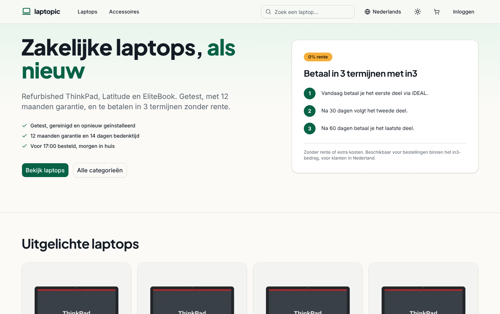
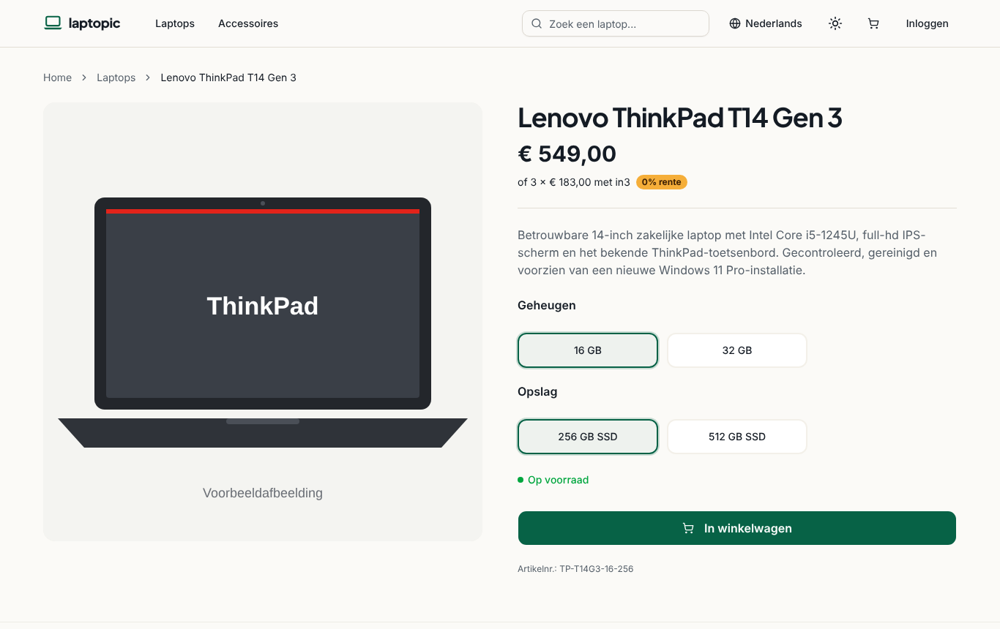
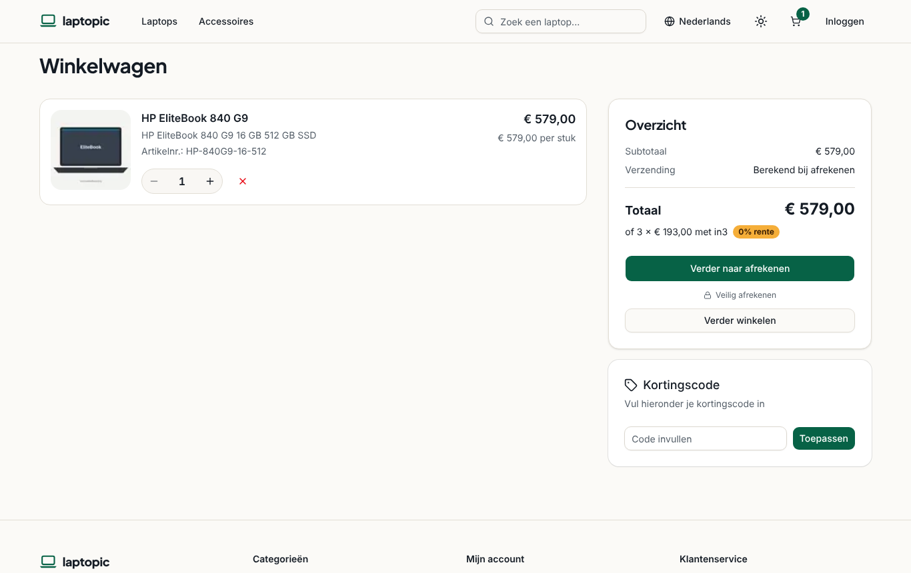
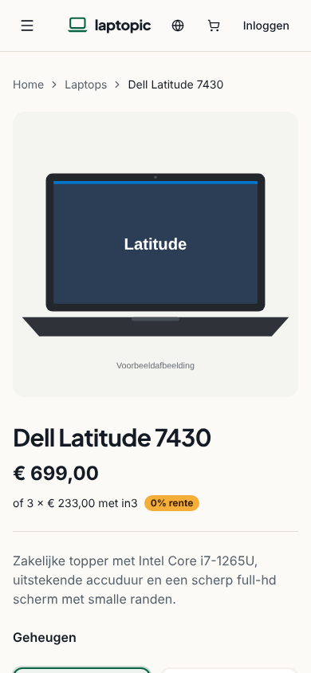
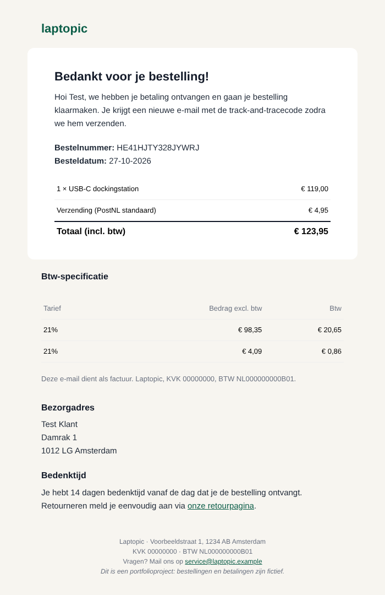
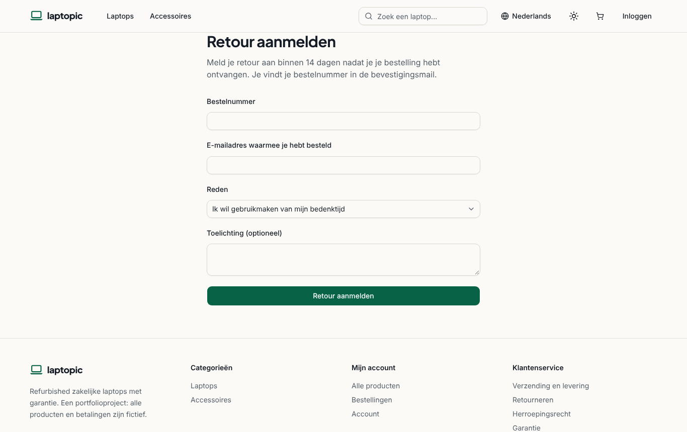
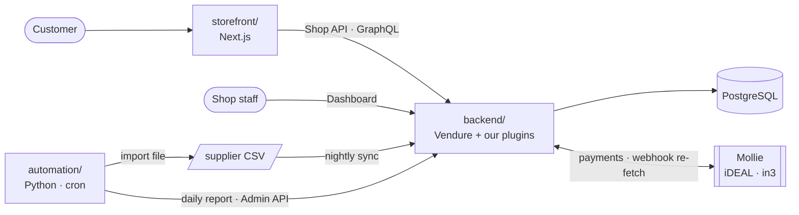

# laptopic

[](https://github.com/efekocagozz/laptopic-showcase/actions/workflows/ci.yml)

A Dutch webshop for refurbished business laptops where customers can pay in **three interest-free installments
with in3** (via Mollie), plus **Python automation** for the shop's daily operations.

**Stack:** TypeScript · Vendure 3 (NestJS, GraphQL) · Next.js 16 · PostgreSQL · Python 3.12 · Docker · Caddy ·
GitHub Actions

> Portfolio project. All products, companies and payments are fictional, and Mollie only runs in test mode.



## Highlights

What this project shows, and where to look:

| | |
|---|---|
| **Business rules on the server** | in3 is only offered for € 50 – 3,000 orders with a Dutch address. A backend plugin decides, and it refuses an ineligible in3 payment before Mollie is called, even when someone bypasses the UI. → [`backend/src/plugins/in3/`](backend/src/plugins/in3/), [ADR 0002](docs/decisions/0002-in3-eligibility-in-the-backend.md) |
| **Safe payment webhooks** | Mollie's webhook body is never trusted: the payment is re-fetched by id. Late and duplicate webhooks are tested, and the confirmation page has a fallback. → [Mollie flow](docs/architecture.md#paying-with-mollie) |
| **Money done right** | Integer cents everywhere, no floats. VAT per rate on the invoice email. Dutch decimal commas are caught in supplier data. |
| **Python process automation** | `laptopic-ops`, a typed CLI run by cron. It turns a messy supplier spreadsheet into the shop's import file and builds a daily report (revenue, iDEAL vs in3, unsettled payments, low stock) from the Admin API. → [`automation/`](automation/README.md), [ADR 0005](docs/decisions/0005-python-ops-automation.md) |
| **Working in an existing codebase** | The storefront is a fork of Vendure's official Next.js starter, translated to Dutch and restyled, with feature-sliced folders and tests that enforce import boundaries. → [ADR 0004](docs/decisions/0004-fork-the-nextjs-starter.md) |
| **Tested** | 30 backend unit tests, 22 backend e2e tests (a real Vendure server, Mollie mocked), 67 Python tests (mypy strict), and Playwright on desktop and mobile. All of it runs in CI, including the Python report against a live seeded backend. |
| **Production-ready setup** | `docker-compose.prod.yml` with Caddy (HTTPS), a separate worker and Postgres. Why Caddy and not Nginx: [ADR 0006](docs/decisions/0006-caddy-as-reverse-proxy.md). The server refuses to start with weak settings. Backups and a security checklist are included. → [docs/deployment.md](docs/deployment.md) |
| **Decisions written down** | Six ADRs, a lessons-learned log and a Dutch/EU legal checklist. → [docs/](docs/) |

## What the shop does

- **Catalogue** of 20 refurbished ThinkPad, Latitude and EliteBook laptops (RAM/SSD variants) and accessories,
  with filters, search, and prices in euros including 21% VAT.
- **in3 where it matters:** "of 3 × € 183,00 met in3" on product pages and in the cart, and in3 at checkout only
  when the order qualifies.
- **Mollie checkout** with iDEAL and in3. Payments are confirmed by Mollie's webhook, with a fallback when the
  webhook is late.
- **Dutch emails:** order confirmation with VAT per rate, shipping notification with track & trace, return
  confirmation.
- **Customer service:** shipping, returns, withdrawal right (with the model form), warranty and terms pages, plus
  an online return form.
- **Supplier sync:** a nightly job imports stock and prices from a supplier CSV and holds back suspicious price
  jumps. The Python `feed` command prepares that CSV from the supplier's own export.

| Product with in3 | Cart | Mobile | Order email | Return form |
|---|---|---|---|---|
|  |  |  |  |  |

## Architecture



Business rules live in the backend as Vendure plugins (`in3`, `returns`, `supplier-sync`), and the storefront
only displays their results. More diagrams: [docs/architecture.md](docs/architecture.md). Decisions:
[docs/decisions/](docs/decisions/). What went wrong and what I learned:
[docs/lessons-learned.md](docs/lessons-learned.md). A short case study:
[docs/portfolio-overview.md](docs/portfolio-overview.md).

## How it was built

The project was developed with an AI coding agent (Claude Code). The agent was steered by a written engineering
standard, [`CLAUDE.md`](CLAUDE.md): architecture rules, naming, money handling, testing and security rules.
Its output was checked with architecture, code and security reviews, decision records and CI on every change.
Reviews changed the code. For example, the code review found a second path to an in3 payment that skipped the
eligibility check. Other catches, such as a demo default that would have overwritten real stock every night,
are described in [lessons learned](docs/lessons-learned.md).

## Run it locally

Requires **Node 24** (npm 11, see `.nvmrc`) and Docker. Python 3.12 is only needed for `automation/`.
Step-by-step guide with logins and test payments: [RUNNING.md](RUNNING.md).

```bash
# Backend: Postgres, demo data, server + worker + Dashboard (http://localhost:5173/dashboard)
cd backend && cp .env.example .env && npm ci && npm run db:up && npm run seed && npm run dev

# Storefront (second terminal): http://localhost:3001
cd storefront && cp .env.example .env.local && npm ci && npm run dev

# Automation (optional)
cd automation && python3.12 -m venv .venv && .venv/bin/pip install -e ".[dev]" && .venv/bin/pytest
```

Use `npm ci`, not `npm install`. Without a Mollie key, check out with the **Testbetaling** method (development
only).

## Tests

| Where | Command | What |
|---|---|---|
| backend | `npm test` | Unit tests: in3 rules, VAT summary, return window, supplier feed parser, catalogue data |
| backend | `npm run test:e2e` | A real Vendure server on in-memory SQLite with Mollie mocked: payments, webhooks, refunds, in3 enforcement, returns, supplier sync |
| storefront | `npm test` | Architecture boundaries and translations |
| storefront | `npm run test:e2e` | Playwright on desktop and mobile: guest checkout, in3 display, service pages, return form |
| automation | `ruff check . && mypy && pytest` | Supplier export parsing and rejection rules, money/VAT rounding, atomic writes, report rules, Admin API client (mocked) |

All of these run in GitHub Actions on every pull request ([ci.yml](.github/workflows/ci.yml)).

## Repository

| Path | What |
|---|---|
| `backend/` | Vendure server, worker, plugins, emails, seed data, e2e tests — [README](backend/README.md) |
| `storefront/` | Next.js storefront, forked from Vendure's official starter — [README](storefront/README.md) |
| `automation/` | `laptopic-ops`: Python CLI for supplier files and daily reports — [README](automation/README.md) |
| `docs/` | Architecture, decisions, plan, legal checklist, lessons learned, deployment, screenshots |
| `PROJECT.md` | The original brief |
| `CLAUDE.md` | The engineering standard used while building this |
