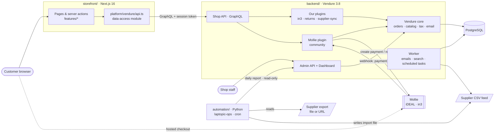

# Architecture

## Overview



- The **storefront never talks to Postgres or Mollie**. It calls the Shop API and redirects the customer to the
  checkout URL that the backend got from Mollie.
- **Business rules live in the backend**: prices and VAT (Vendure core), in3 eligibility (`plugins/in3`), return
  rules (`plugins/returns`), feed validation (`plugins/supplier-sync`). The storefront displays the results.
- The **worker** runs background jobs: sending emails, updating the search index, and the nightly supplier sync.
- **Operations automation** (`automation/`, Python) runs outside the shop, from cron. It prepares the supplier
  import file and reads a daily report from the Admin API. It never changes shop data. See
  [ADR 0005](decisions/0005-python-ops-automation.md).

## Paying with Mollie

```mermaid
sequenceDiagram
    actor C as Customer
    participant S as Storefront
    participant V as Vendure (Shop API)
    participant M as Mollie

    C->>S: Bestelling plaatsen (in3)
    S->>V: createMolliePaymentIntent(method: in3)
    Note over V: In3PaymentInterceptor checks eligibility
    V->>M: create payment (amount, lines, billing address)
    M-->>V: checkout URL
    V-->>S: checkout URL
    S-->>C: redirect to Mollie
    C->>M: pays the first installment
    M->>V: webhook (payment id only)
    V->>M: GET payment (re-fetch; the webhook body is not trusted)
    Note over V: order → PaymentSettled, confirmation email queued
    M-->>C: redirect to /order-confirmation/CODE
    C->>S: confirmation page
    S->>V: orderByCode (polls; after 10 s syncMolliePaymentStatus)
```

## Where things are

| Concern | Location |
|---|---|
| Configuration (all from `.env`) | `backend/src/vendure-config.ts` |
| in3 rules and Shop API fields | `backend/src/plugins/in3/` — pure rules in `in3-quote.ts` |
| Return requests | `backend/src/plugins/returns/` |
| Supplier stock/price import | `backend/src/plugins/supplier-sync/` |
| Emails | `backend/src/email/`, `backend/static/email/templates/` |
| Supplier file preparation, daily ops report (Python) | `automation/` |
| Demo data | `backend/src/seed/` |
| Backend e2e tests | `backend/test/` |
| Storefront features | `storefront/src/features/*` (checkout, products, cart, orders, returns, info, pricing, ...) |
| Storefront shell (navbar, footer, home) | `storefront/src/site/` |
| Browser tests | `storefront/e2e/` |

## Decisions

See [`docs/decisions/`](decisions/):

1. [Use the community Mollie plugin for iDEAL and in3](decisions/0001-mollie-plugin-for-ideal-and-in3.md)
2. [in3 eligibility is decided by a backend plugin](decisions/0002-in3-eligibility-in-the-backend.md)
3. [Vendure + Next.js instead of Shopify, WooCommerce or Medusa](decisions/0003-vendure-and-nextjs.md)
4. [Fork the official Next.js starter](decisions/0004-fork-the-nextjs-starter.md)
5. [Operations automation as a separate Python tool](decisions/0005-python-ops-automation.md)
